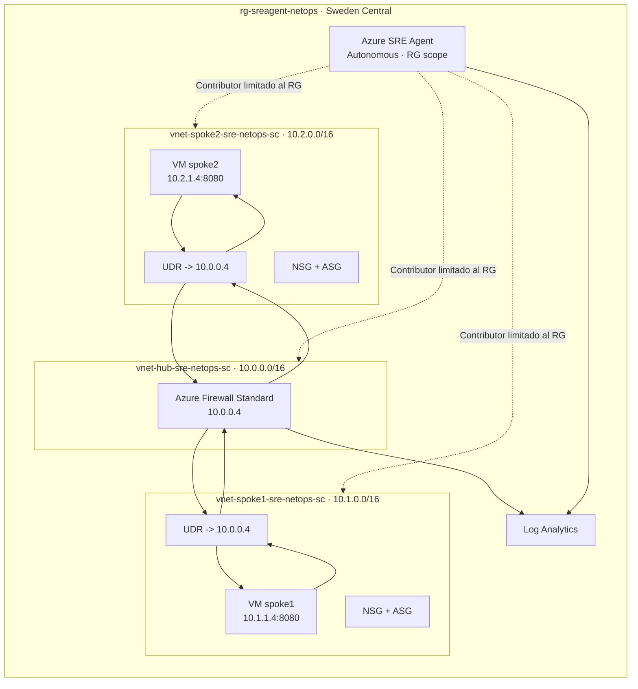

# Arquitectura

## Flujo de tráfico

No existe peering directo entre spokes. Las UDR más específicas de cada subnet envían el prefijo del spoke opuesto a `10.0.0.4`. Azure Firewall permite TCP/8080 en ambos sentidos y registra la decisión en Log Analytics.

Las dos VM sirven una página HTTP y ejecutan una sonda cada minuto. No tienen IP pública. Azure SRE Agent puede inspeccionar configuración, Activity Log, telemetría y, cuando sea necesario, ejecutar diagnósticos sobre las VM dentro del RG.

## Scope del agente

El agente y sus identidades tienen roles únicamente en `rg-sreagent-netops`. Aunque el conector Azure Monitor usa el endpoint de la suscripción, la identidad no dispone de permisos heredados fuera del RG. El modo de acción es `Autonomous` y el nivel de acceso es `High`, necesario para corregir rutas, reglas y asociaciones.

## Naming CAF

Se usan prefijos como `rg`, `vnet`, `snet`, `afw`, `afwp`, `rt`, `nsg`, `asg`, `nic`, `vm`, `pip`, `log`, `appi` e `id`, seguidos de workload, función y región abreviada.
